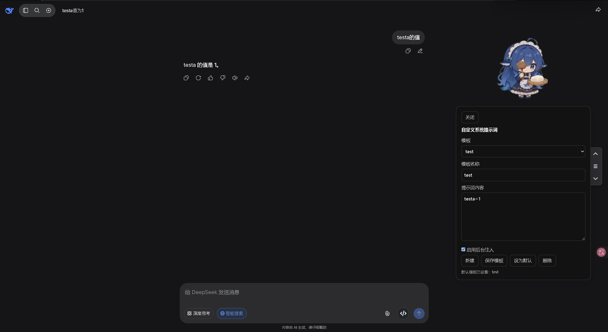

# DeepSeek 大肥鱼插件

运行于 `chat.deepseek.com` 的油猴脚本，包含两部分：

1. **自定义提示词**：多模板管理，在发起对话的请求里注入一次。
2. **大肥鱼桌宠**：透明动画挂件，支持拖拽、甩抛、点击回应与随机动作。



## 安装

构建产物为 `dist/ds-custom-prompt.user.js`，拖入 Tampermonkey 安装即可。

脚本头部的 `@downloadURL` / `@updateURL` 指向：

```
https://gitee.com/Ljunyang114/ds-web-plug/raw/main/dist/ds-custom-prompt.user.js
```

## 构建

```sh
npm install
npm run build
```

产物输出到 `dist/`。开发时用 `npm run dev`。

## 使用

### 提示词

宠物开启时，右键大肥鱼 →「提示词」打开面板；宠物关闭时，右下角有「提示词」按钮。

- **模板**：新建 / 保存 / 设为默认 / 删除。
- **启用后台注入**：关闭后不再改写请求。
- **注入范围**：仅 `/api/v0/chat/completion`，且每条会话只在第一条消息注入一次；标记持久化，刷新页面后同一会话不会重复注入。
- **历史清理**：刷新页面后，`/api/v0/chat/history_messages` 响应中的注入内容会被剥掉，聊天记录里只显示用户原文。

注意：DeepSeek 网页端请求体只有 `prompt` 字段，没有 `messages` / `system_prompt`。因此注入内容属于用户消息前缀，不是真正的 system prompt。

### 大肥鱼

- 左键点击：回应动画 + Q 弹。
- 拖拽：弹簧跟手；快速甩出会抛掷，碰边反弹、落地 Q 弹。
- 双击后按住拖拽：弹弓。
- 右键菜单：
  - 提示词
  - 关闭动画（关闭后右下角出现提示词按钮）
  - 回到初始位置（拖出屏幕后用它找回）
- 重新开启：双击右下角「提示词」按钮。

宠物位置与开关状态保存在油猴存储里，刷新后保留。

## 目录

```
src/
  main.js            入口：安装拦截器、挂载宠物或提示词按钮
  constants.js       存储键、注入标记、目标接口
  store.js           GM 读写、会话标记
  presets.js         模板状态
  injector.js        请求体注入
  history.js         历史响应清理
  interceptors.js    fetch / XHR / WebSocket 拦截
  ui/                提示词面板与样式
  pet/               大肥鱼挂件
    widget.js        挂载、播放、拖拽抛掷、菜单
    assets.js        素材加载（Gitee 优先，GitHub 兜底）
    config.js        动作池与物理参数
    physics.js       拖拽/抛掷物理
    pickers.js       随机动作选择
    motion.js        走位规划
    state.js         开关状态
assets/pet/webm/     106 个透明 webm 动画
dist/                构建产物
tmp/                 参考文件（网页源码、dsh-pet 仓库）
```

## 素材来源

宠物动画、动作池与物理参数取自 [dsh-pet](https://github.com/PC2005-cloud/dsh-pet)，MIT License，Copyright (c) 2026 PC2005-cloud。

素材运行时会从 Gitee 仓库的 `assets/pet/webm/` 拉取，失败时回落到 GitHub raw。

## 许可

本项目同样以 **MIT License** 开源，协议全文见仓库根目录的 [LICENSE](LICENSE)，Copyright (c) 2026 LLL。

宠物素材版权归 dsh-pet 原作者，禁止商用；二创在公开渠道须署名 [dsh-pet](https://github.com/PC2005-cloud/dsh-pet)。
